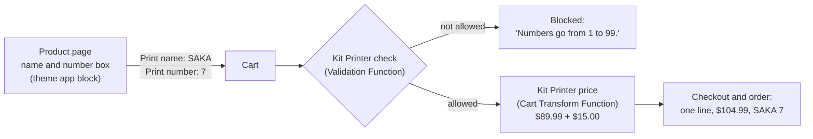

<p align="center"></p>

# Kit Printer

**Names and numbers on football kits, priced and checked inside Shopify's own checkout.**

I buy a lot of football kits, and I'm building my own Shopify store to sell them. Every kit shop needs the same thing: type a name and a number, see it on the shirt, pay a bit extra for the printing. On Shopify that's done by "product options" apps, and their 1-star reviews all tell the same story: they **break when the store changes its theme**, and **custom names go missing from orders**.

That's because they live in the theme's JavaScript. Kit Printer doesn't. The price and the rules run inside Shopify's checkout as **Shopify Functions**, so a theme change can't break them and a bad print can't reach an order, even if someone skips the product page.

## Try it

**[kitsbyzizo.pages.dev](https://kitsbyzizo.pages.dev)** is the store: my own React site on Shopify's Storefront API, with Kit Printer doing the pricing and checking inside Shopify.

1. Open any kit, pick **Personalize** and type a name and number. The shirt turns round and prints it as you type.
2. Add it to the bag: $89.99 becomes **$104.99**, a price set by Shopify, not by the site.
3. Try number `100`, or an emoji in the name. It's refused before it reaches the cart, in Shopify's own words.
4. Try the socks: there's no name and number at all, because they can't be printed.
5. Checkout is Shopify's. It's a test store, so it asks for a password: **`futureshopifolk`**. Payments are fake.

Kit Printer is a Shopify app, so it also works in any ordinary Shopify theme. That version runs on the same store's theme at [kitsbyzizo.myshopify.com](https://kitsbyzizo.myshopify.com) (same password).

The four kits are **original designs for made-up clubs**. No real club or brand appears anywhere.

## How it works



There are three pieces, and no server. Shopify runs all of them, so there's nothing for me to host and nothing to go down:

| Piece | What it does | Where |
|---|---|---|
| **The box** | Name and number fields with a live preview of the back of the shirt in the kit's own colours. It writes the name in capitals and stops a bad print before it's added. | `extensions/kit-printer-block` |
| **The check** | Refuses a cart with a name or number that can't be printed, or a print on a product that can't be printed. This is the one that can't be skipped. | `extensions/kit-printer-check` |
| **The price** | Raises the shirt's own price by the product's print price. There's no separate "printing" item, so changing the quantity can never leave the charge behind. | `extensions/kit-printer-price` |

All three use **one rules file**, `shared/print.js`: letters, spaces, hyphens, apostrophes and full stops, up to 12 characters (VAN DIJK, O'BRIEN, SMITH-ROWE), and numbers 1 to 99. The box gets an exact copy (`npm run sync`), and a test fails if the copy drifts. So the page can never allow something the checkout refuses, or the other way round.

Money is added in whole cents, so $89.99 + $15.00 is always $104.99, never $104.99000000000001.

## A custom storefront too

Kit Printer works with any Shopify theme, but I also built a store from scratch to show it doesn't need one:
**[kitsbyzizo.pages.dev](https://kitsbyzizo.pages.dev)**. It's my own React site on Shopify's **Storefront API**, so
the design is all mine, while the cart, the price and the checks stay inside Shopify.

- Products and carts come from the Storefront API. The site only says what to print (two cart line attributes);
  the **Cart Transform** sets the price, so the bag shows Shopify's own $104.99, not a number the browser made up.
- The **Cart Validation**'s refusals are shown word for word. The form checks as you type with the same
  `shared/print.js`, so nothing the site lets through is refused at checkout.
- The shirt turns to the back as you type and draws your name at the exact place and size the printed kit uses.
- Shopify's own checkout takes the payment. The store is a test store, and unlocking it lands on its home page, not
  the checkout, so the bag does it in two steps: unlock in a new tab, then continue to checkout.
- With no Storefront token it runs a demo mode that executes the **real Function code** in the browser, so the
  site can be built and tested without a store.

Code in [`storefront/`](storefront): React 19, Vite, Tailwind 4, Motion, Vitest and Playwright, hosted on
Cloudflare Pages. Its [How it's built](https://kitsbyzizo.pages.dev/how-its-built) page walks through one
add-to-bag, step by step.

## What broke

The bugs are the interesting part, so I wrote them up in **[WHAT-BROKE.md](WHAT-BROKE.md)**. The best one: the box showed SAKA 7 on the shirt, but the cart never got it. Shopify's add-to-cart form has a hidden field called `id`, and in a browser a field's name hides the form's own `id`. So my code pointed the boxes at a form that didn't exist. One line to fix, and a test so it can't come back.

## Tested on the real store

- SAKA 7 on an $89.99 kit came to **$104.99** in Shopify's checkout, on one line, with the name and number on the order.
- Number 100, an emoji name and a print on socks were all refused, in the theme and on the storefront.
- Three SAKA 7 kits came to $314.97: the print price follows the quantity, with no separate "printing" item to lose.
- The storefront's own tests run the same buy flow against the live store, on desktop and phone sizes.

```bash
npm test                           # the rules, both Functions, and the theme box
cd storefront && npm test          # the storefront: data layer, product page, bag, checkout sheet
```

I also break the code on purpose (accept number 100, skip the "can this product be printed" check, charge a bad print) to make sure the tests notice. They did, every time.

## Limits

- One currency: the print price is in the store's currency.
- Shopify only runs custom apps with Functions on Plus and test stores, so this lives on my test store unless it's published to the App Store.
- The box needs the theme's standard add-to-cart form. If a theme doesn't have one, the box says printing isn't available, and the checkout rules still apply.

## Run it

You need Node 22+, the Shopify CLI and a development store.

```bash
npm install
npm test
shopify app config link   # create or pick the app in your Dev Dashboard
shopify app deploy        # the two Functions and the product page block
```

Then, once per store:

1. Switch the price on: in GraphiQL (press `g` while `shopify app dev` runs), run `cartTransformCreate(functionHandle: "kit-printer-price")`.
2. Switch the check on: Settings, Checkout, Checkout rules, add **Kit Printer check**.
3. Give each printable product a `kit_printer.print_price` (and optionally `shirt_colour`, `print_colour` and a `back_image` of the blank back).
4. Add the Kit Printer block to the product template in the theme editor, with `shopify app dev` stopped.

The storefront runs on its own:

```bash
cd storefront
npm install
npm run dev     # with no token it runs in demo mode, on the real Function code
```

Put a public Storefront API token from the Headless channel in `storefront/.env.production` (`VITE_STORE_DOMAIN`, `VITE_STOREFRONT_TOKEN`) to build against a real store.

## Built with

Shopify Functions (Cart Transform and Cart Validation, API 2026-07), a theme app extension, the Shopify CLI, and plain JavaScript with Node's built-in test runner. The storefront: the Storefront API (2026-04), React 19, Vite, Tailwind 4, Motion, Vitest and Playwright on Cloudflare Pages.
