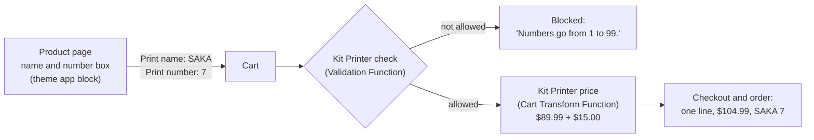

<p align="center"></p>

# Kit Printer

**Names and numbers on football kits, priced and checked inside Shopify's own checkout.**

I buy a lot of football kits, and I'm building my own Shopify store to sell them. Every kit shop needs the same thing: type a name and a number, see it on the shirt, pay a bit extra for the printing. On Shopify that's done by "product options" apps, and their 1-star reviews all tell the same story: they **break when the store changes its theme**, and **custom names go missing from orders**.

That's because they live in the theme's JavaScript. Kit Printer doesn't. The price and the rules run inside Shopify's checkout as **Shopify Functions**, so a theme change can't break them and a bad print can't reach an order, even if someone skips the product page.

## Try it

The demo store is **[kitsbyzizo.myshopify.com](https://kitsbyzizo.myshopify.com)**. It's a Shopify test store, so it asks for a password, and payments are fake.

1. Open any kit and type a name and number. The shirt fills in as you type.
2. Add it to the cart: the price goes up by $15.00 for the printing, on the shirt's own line.
3. Try number `100`, or an emoji in the name. You're stopped before it ever reaches the cart.
4. Try the socks: there's no box at all, because they can't be printed.

The four kits are **original designs for made-up clubs**. No real club or brand appears anywhere.

## How it works



There are three pieces, and no server. Shopify runs all of them, so there's nothing for me to host and nothing to go down:

| Piece | What it does | Where |
|---|---|---|
| **The box** | Name and number fields with a live preview of the back of the shirt in the kit's own colours. It writes the name in capitals and stops a bad print before it's added. | `extensions/kit-printer-block` |
| **The check** | Refuses a cart with a name or number that can't be printed, or a print on a product that can't be printed. This is the one that can't be skipped. | `extensions/kit-printer-check` |
| **The price** | Raises the shirt's own price by the product's print price. There's no separate "printing" item, so changing the quantity can never leave the charge behind. | `extensions/kit-printer-price` |

All three use **one rules file**, `shared/print.js`: letters, spaces, hyphens, apostrophes and full stops, up to 12 characters (VAN DIJK, O'BRIEN, SMITH-ROWE), and numbers 1 to 99. The box gets an exact copy (`npm run sync`), and a test fails if the copy drifts. So the page can never allow something the checkout refuses, or the other way round.

Money is added in whole cents, so $89.99 + $15.00 is always $104.99, never $104.99000000000001.

## What broke

The bugs are the interesting part, so I wrote them up in **[WHAT-BROKE.md](WHAT-BROKE.md)**. The best one: the box showed SAKA 7 on the shirt, but the cart never got it. Shopify's add-to-cart form has a hidden field called `id`, and in a browser a field's name hides the form's own `id`. So my code pointed the boxes at a form that didn't exist. One line to fix, and a test so it can't come back.

## Tested on the real store

- **Day 1:** SAKA 7 came to $104.99, and number 100, an emoji name and printing on socks were all refused.
- **Day 2:** the box, on the released app with dev mode off.

Each test day has a report in [`reports/`](reports).

```bash
npm test   # 21 tests: the rules, both Functions, and the box
```

I also break the code on purpose (accept number 100, skip the "can this product be printed" check, charge a bad print) to make sure the tests notice. They did, every time.

## Limits

- One currency: the print price is in the store's currency.
- Shopify only runs custom apps with Functions on Plus and test stores, so this lives on my test store unless it's published to the App Store.
- The box needs the theme's standard add-to-cart form. If a theme doesn't have one, the box says printing isn't available, and the checkout rules still apply.

## Built with

Shopify Functions (Cart Transform and Cart Validation, API 2026-07), a theme app extension, the Shopify CLI, and plain JavaScript with Node's built-in test runner.
